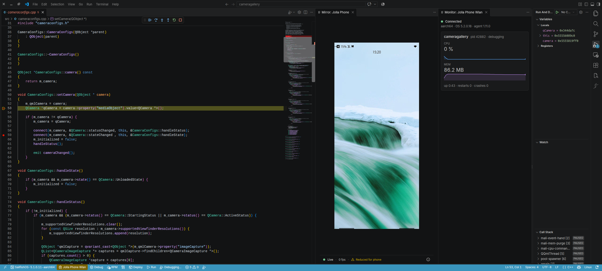

# Sardina

Build, run and debug Sailfish OS apps from VS Code.

> **Independent project.** This is a personal hobby project. It is not
> affiliated with, endorsed by or made for Jolla or any other company.
> Sailfish OS is a trademark of Jolla; the name is used here only to say
> which platform the extension works with.



## What it does

A VS Code extension that connects to the Sailfish SDK so you can develop
on a device or the emulator without leaving the editor.

- Build, deploy, run and debug your app with status bar buttons.
- Debug C++ on the device with gdbserver.
- Debug QML/JavaScript on the device with the Qt QML extension (see the
  [Qt 5.6 compatibility note](docs/setup.md#qml-and-javascript-debugging)).
- Mirror the device screen live, with touch and keypad control.
- Stream device logs into VS Code.
- Device Monitor tab: connection, CPU, memory, crashes per device.
- Phone-side settings for screen view, control and logs.
- Clean install and uninstall of the device agent; nothing left behind.
- Silica QML snippets, completion, hover and checks for unknown types and properties, and no telemetry.

## Quick start

1. Install [VirtualBox](https://www.virtualbox.org/wiki/Downloads) and the
   [Sailfish SDK (Sailfish SDK)](https://docs.sailfishos.org/Tools/Sailfish_SDK/Installation/)
   (3.10+). VS Code 1.94+ on Linux (macOS untested).
2. Install the extension from its `.vsix` file (see [Setup](docs/setup.md)).
3. Open a Sailfish OS project folder.
4. Pick a build target and a device in the status bar.
5. Click **Run** (Ctrl+Alt+R) or **Debug**.

### Remove phone-side development tools

Use **Sardina: Remove Deploy & Debug Tools from Device** in the command palette
or the device's context menu beside Install. Confirm removal of the installed tools and
enter the Developer Mode password. The notification shows progress and the
Sardina output contains phase changes and results. These tools are shared with
the Sailfish SDK and Qt Creator; removing them disables the related features.

Alternatively, to remove only the C++ and QML/JavaScript
debuggers, connect to the phone over Developer Mode SSH and run:

```sh
ssh defaultuser@<device-ip>
devel-su pkcon --plain remove -y gdb-gdbserver qt5-qtdeclarative-plugin-qmlinspector
```

Enter the Developer Mode password when `devel-su` asks. To remove the deploy
helpers too, add `rsync sdk-deploy-rpm` to the `pkcon remove` command. This does
not remove Sardina's device agent or any applications.

## Documentation

- [Features](docs/features.md) -- everything the extension does.
- [Setup](docs/setup.md) -- from VirtualBox to package signing.
- [Device agent](docs/device-agent.md) -- screenshots, logs, screen mirror
  and how it stays safe.
- [Device Monitor](docs/device-monitor.md) -- the per-device tab.
- [Troubleshooting](docs/troubleshooting.md) -- common errors and known
  issues.
- [Architecture](docs/architecture.md) -- how the extension is built.
- [Development](docs/development.md) -- build from source and run the tests.
- [Changelog](CHANGELOG.md)

## What's next

- Target-aware C++ indexing is planned, not implemented. It is currently
  scheduled for v0.1.15.
- Profiling (CPU, memory, QML) in a later version.

## Status

Version 0.1.14. Not on the VS Code Marketplace yet.

| Linux | macOS | Windows |
|---|---|---|
| Tested | Untested | N/A |

## License

LGPL-3.0-or-later. See [LICENSE](LICENSE) and [third-party notices](THIRD_PARTY_NOTICES).

Published by `sailfish-tools-dev`, a placeholder id that does not stand for
Jolla or any company.
